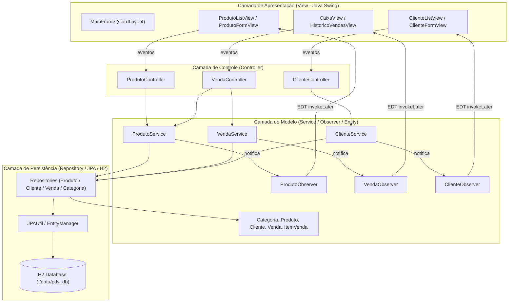
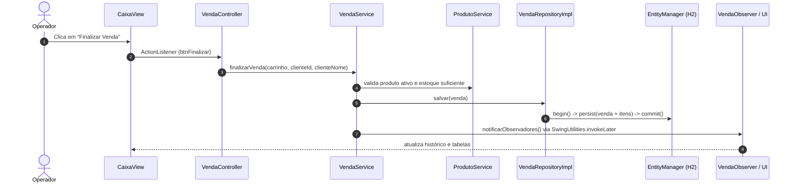

<h1 align="center">Sabor Express Lanchonete — Sabor Express PDV</h1>

<p align="center">
  <strong>Sistema Desktop de Ponto de Venda (PDV) e Gestão para Lanchonetes e Fast-Food</strong>
</p>

<p align="center">
  
  
  
  
  
  
  
</p>

---

## 1. Visão Geral e Funcionalidades

O **Sabor Express PDV** é uma aplicação desktop desenvolvida para atender às necessidades operacionais de **lanchonetes e estabelecimentos de fast-food**, oferecendo controle de cardápio, frente de caixa, gerenciamento de clientes, controle de estoque e histórico de vendas com cancelamento e estorno transacional.

### Módulos Entregues

- **Gestão de Cardápio com Categorias:**
  - Organização lógica dos itens em categorias (`Lanche`, `Bebida`, `Acompanhamento` e `Sobremesa`).
  - Cadastro, edição, ativação/inativação (`ativo`) e remoção de produtos (`ProdutoListView`, `ProdutoFormView`).
  - Busca dinâmica com *debounce* (1,5 s) e normalização sem acentos, além de filtro por texto/código de barras.

- **Frente de Caixa (PDV):**
  - Tela de checkout (`CaixaView`) com listagem exclusiva de produtos ativos no cardápio.
  - Carrinho dinâmico para adição, remoção e limpeza de itens, com cálculo automático de subtotais e total geral em tempo real (`BigDecimal` formatado em `pt-BR`).
  - Seleção opcional de cliente para vincular ao pedido e finalização com baixa de estoque atômica.

- **Controle de Estoque Inteligente:**
  - Configuração de `estoque` atual e `estoqueMinimo` por produto.
  - Alertas visuais diretamente na tabela do cardápio (`ProdutoListView`): destaque em **laranja** para estoque baixo (`estoque <= estoqueMinimo`) e **vermelho em negrito** para estoque zerado.
  - Bloqueio transacional estrito de vendas para produtos inativos (`ProdutoInativoException`) ou com estoque insuficiente (`EstoqueInsuficienteException`).

- **Histórico, Detalhes e Cancelamento de Vendas:**
  - Listagem sincronizada de todas as vendas registradas (`HistoricoVendasView` com `VendaTableModel`).
  - Exibição automática dos itens da venda selecionada (`ItensVendaTableModel`), incluindo quantidade, preço unitário e subtotal.
  - Cancelamento de vendas finalizadas com estorno atômico de estoque dos produtos e transição de status para `CANCELADA`.

- **Gestão de Clientes:**
  - CRUD completo de clientes (`ClienteListView`, `ClienteFormView`) com validações de negócio no `ClienteService` e atualização reativa da tabela.

- **Carga Inicial de Dados (Seed):**
  - População automática e idempotente das categorias e itens de lanchonete na inicialização da aplicação por meio da classe `DataLoader` (inspirada no padrão `CommandLineRunner`) e script `import.sql`.

> **Nota sobre o módulo de Dashboard:** Conforme registrado no histórico do repositório (commit `535d161`), o módulo de Dashboard/métricas agregadas foi removido do escopo desta versão para manter a entrega focada nos fluxos principais de Cardápio, Clientes, Caixa e Histórico de Vendas.

---

## 2. Arquitetura e Decisões de Design

O projeto aplica uma arquitetura em camadas alinhada ao padrão **MVC (Model-View-Controller)**, combinada com **Repository**, **Service Layer**, **Observer (GoF)** e **Pure Dependency Injection (Composition Root)** na classe `Main`.

### Separação de Responsabilidades (MVC + Camadas)

- **View (`view/` e `view/tablemodel/`):**
  - Telas construídas em **Java Swing** com tema moderno **FlatLaf** (`FlatLightLaf`) e navegação via `CardLayout` no `MainFrame` (`Sabor Express PDV - Gestão de Lanchonete`).
  - As Views são estritamente passivas quanto a regras de negócio e persistência: **não acessam repositórios, `EntityManager` ou SQL diretamente**.
- **Controller (`controller/`):**
  - `ProdutoController`, `ClienteController` e `VendaController` atuam como mediadores entre Views e Services, capturando eventos da interface, validando entradas básicas e exibindo feedbacks amigáveis via `JOptionPane`.
- **Service (`model/service/`):**
  - `ProdutoService`, `ClienteService` e `VendaService` concentram as regras de negócio, validações de domínio (ex.: estoque suficiente, produto ativo, integridade de cliente) e coordenação de observadores.
  - Exceções de domínio dedicadas (`BusinessException`, `ValidationException`, `EstoqueInsuficienteException`, `ProdutoInativoException`, `PersistenceException`) garantem tratamento claro sem expor detalhes internos de banco.
- **Repository (`model/repository/`):**
  - Interfaces e implementações JPA (`*RepositoryImpl`) isolam completamente o acesso ao `EntityManager` obtido via `JPAUtil`.
  - Todas as operações de escrita utilizam controle explícito de transação (`begin`, `commit`, `rollback` em caso de falha), garantindo atomicidade na finalização e no cancelamento de vendas.
  - Nenhuma instrução SQL é concatenada manualmente: todas as consultas utilizam **JPA / Hibernate** com `NamedQuery` e parâmetros nomeados.

### Bootstrap e Injeção de Dependências

- A classe `Main` atua como **Composition Root**, instanciando os repositórios, executando o `DataLoader` (padrão *CommandLineRunner* para seed idempotente), construindo os serviços e conectando os controladores ao `MainFrame` dentro da **Event Dispatch Thread (EDT)**.
- O `pom.xml` inclui `spring-data-jpa` (`3.2.0`) e `hibernate-core` (`6.4.4.Final`) sobre `jakarta.persistence-api` (`3.1.0`), mantendo o ciclo de vida JPA enxuto para desktop via `RESOURCE_LOCAL` em `persistence.xml`.

### Padrão Observer e Thread-Safety no Swing (EDT)

Para manter todas as telas sincronizadas após cadastros, edições, vendas ou cancelamentos:

- Os serviços mantêm listas de observadores (`ProdutoObserver`, `VendaObserver`, `ClienteObserver`).
- Após concluir operações que alteram o estado persistido, o serviço dispara `notificarObservadores()`.
- O despacho para a interface gráfica é sempre encapsulado em `SwingUtilities.invokeLater(...)`, garantindo que a atualização dos `TableModel`s (`ProdutoTableModel`, `VendaTableModel`, `ClienteTableModel`) e componentes Swing ocorra com segurança na **Event Dispatch Thread (EDT)**.

---

## 3. Pré-requisitos de Ambiente

Certifique-se de ter instalado e configurado no ambiente de desenvolvimento:

- **Java Development Kit (JDK) 17 (LTS)** ou superior compatível, com a variável de ambiente `JAVA_HOME` configurada e `java` disponível no `PATH`.
- **Maven Wrapper** (`mvnw.cmd` no Windows / `mvnw` no Linux e macOS) já incluído no repositório — dispensa instalação prévia do Maven (ou utilize Maven `3.8+` se preferir).
- **Git** para clonagem e versionamento.
- **Sistemas Operacionais Suportados:** Windows, Linux e macOS (qualquer ambiente com suporte gráfico para Java Swing).

---

## 4. Instruções Passo a Passo de Execução

### 4.1. Clonar o Repositório

```bash
git clone https://github.com/jenifferCamar/projeto-caina.git
cd projeto-caina
```

### 4.2. Executar os Testes Automatizados

Antes de subir a aplicação, você pode validar a suíte de testes JUnit 5 (executada em banco H2 em memória `pdv-test-pu`):

**Windows (PowerShell / CMD):**

```powershell
.\mvnw.cmd test
```

**Linux / macOS:**

```bash
./mvnw test
```

### 4.3. Compilar e Executar via Maven Wrapper

**Windows (PowerShell / CMD):**

```powershell
.\mvnw.cmd compile exec:java -Dexec.mainClass="br.fiesp.senai.unisenai.saborexpress.pdv.Main"
```

**Linux / macOS:**

```bash
./mvnw compile exec:java -Dexec.mainClass="br.fiesp.senai.unisenai.saborexpress.pdv.Main"
```

> **Dica:** Como a `mainClass` já está configurada no `exec-maven-plugin` dentro do `pom.xml`, `.\mvnw.cmd exec:java` (ou `./mvnw exec:java`) também inicia o sistema diretamente após a compilação.

### 4.4. Empacotar e Executar via JAR

O build Maven gera o JAR executável em `target/` e copia todas as dependências para `target/lib/` via `maven-dependency-plugin`:

**Windows (PowerShell / CMD):**

```powershell
.\mvnw.cmd clean package
java -jar target/exemplo_persistencia_JavaSwing-1.0.0.jar
```

**Linux / macOS:**

```bash
./mvnw clean package
java -jar target/exemplo_persistencia_JavaSwing-1.0.0.jar
```

### 4.5. Importar e Rodar por IDEs

- **IntelliJ IDEA:** `File` → `Open...` → selecione o arquivo `pom.xml` (abrir como Projeto Maven) → aguarde o sync e execute o método `main` em `src/main/java/br/fiesp/senai/unisenai/saborexpress/pdv/Main.java`.
- **Eclipse:** `File` → `Import...` → `Maven` → `Existing Maven Projects` → selecione a pasta raiz do repositório → execute `Main.java` como `Java Application`.
- **VS Code:** Abra a pasta do repositório com a extensão **Extension Pack for Java** instalada → aguarde o carregamento do projeto Maven e clique em `Run` acima do método `main` em `Main.java`.

---

## 5. Banco de Dados H2

A aplicação utiliza o **H2 Database (`2.2.224`)** em modo embutido, dispensando instalação externa de SGBD.

### Configuração Principal (`pdv-pu`)

Definida em [`src/main/resources/META-INF/persistence.xml`](src/main/resources/META-INF/persistence.xml):

| Propriedade | Valor |
|---|---|
| **Unidade de Persistência** | `pdv-pu` (`RESOURCE_LOCAL`) |
| **Driver JDBC** | `org.h2.Driver` |
| **URL JDBC** | `jdbc:h2:./data/pdv_db;DB_CLOSE_DELAY=-1;AUTO_SERVER=TRUE` |
| **Usuário** | `sa` |
| **Senha** | *(vazia)* |
| **Estratégia DDL (`hbm2ddl.auto`)** | `update` |
| **Script Inicial** | `import.sql` |

- Os dados são persistidos localmente na pasta `./data/` (arquivos `pdv_db.mv.db` e auxiliares).
- A flag `AUTO_SERVER=TRUE` permite conectar ferramentas externas (como **DBeaver** ou **H2 Console** standalone) utilizando a mesma URL JDBC enquanto a aplicação está em execução.
- Para os testes automatizados, utiliza-se a unidade `pdv-test-pu` com banco em memória (`jdbc:h2:mem:pdv_test_db;DB_CLOSE_DELAY=-1`) e `hibernate.hbm2ddl.auto=create-drop`.

> **Resetando o banco local:** Caso deseje recriar a base do zero (por exemplo, após alterações de schema), encerre a aplicação e remova os arquivos `./data/pdv_db*` antes de iniciar novamente.

---

## 6. Estrutura de Pastas e Organização do Código

```text
projeto-caina/
├── 2.png                                      # Logo oficial Sabor Express Lanchonete
├── pom.xml                                    # Dependências e plugins Maven (Java 17)
├── mvnw / mvnw.cmd                            # Maven Wrapper (Linux/macOS e Windows)
├── CONTRIBUTING.md                            # Regras de Gitflow e Conventional Commits
├── PLANEJAMENTO_PDV_LANCHES.md                # Planejamento de trilhas e cards do PBL
└── src/
    ├── main/
    │   ├── java/br/fiesp/senai/unisenai/saborexpress/pdv/
    │   │   ├── Main.java                      # Composition Root, Look&Feel (FlatLaf) e Bootstrap EDT
    │   │   ├── config/
    │   │   │   └── DataLoader.java            # Carga inicial idempotente de categorias e cardápio
    │   │   ├── controller/                    # Orquestração MVC entre Views e Services
    │   │   │   ├── ClienteController.java
    │   │   │   ├── ProdutoController.java
    │   │   │   └── VendaController.java
    │   │   ├── model/
    │   │   │   ├── entity/                    # Entidades JPA e objetos de domínio
    │   │   │   │   ├── Categoria.java
    │   │   │   │   ├── Cliente.java
    │   │   │   │   ├── ItemCarrinho.java
    │   │   │   │   ├── ItemVenda.java
    │   │   │   │   ├── Produto.java
    │   │   │   │   └── Venda.java
    │   │   │   ├── exception/                 # Exceções de negócio, validação e persistência
    │   │   │   │   ├── BusinessException.java
    │   │   │   │   ├── EstoqueInsuficienteException.java
    │   │   │   │   ├── PersistenceException.java
    │   │   │   │   ├── ProdutoInativoException.java
    │   │   │   │   └── ValidationException.java
    │   │   │   ├── observer/                  # Interfaces Observer para reatividade na UI
    │   │   │   │   ├── ClienteObserver.java
    │   │   │   │   ├── ProdutoObserver.java
    │   │   │   │   └── VendaObserver.java
    │   │   │   ├── repository/                # Interfaces e implementações JPA (commit/rollback)
    │   │   │   │   ├── CategoriaRepository.java / CategoriaRepositoryImpl.java
    │   │   │   │   ├── ClienteRepository.java / ClienteRepositoryImpl.java
    │   │   │   │   ├── ProdutoRepository.java / ProdutoRepositoryImpl.java
    │   │   │   │   └── VendaRepository.java / VendaRepositoryImpl.java
    │   │   │   └── service/                   # Regras de negócio e notificação de observers
    │   │   │       ├── ClienteService.java
    │   │   │       ├── ProdutoService.java
    │   │   │       └── VendaService.java
    │   │   ├── util/
    │   │   │   ├── FormatUtils.java           # Formatação de moeda (pt-BR) e máscaras
    │   │   │   └── JPAUtil.java               # Singleton EntityManagerFactory (pdv-pu)
    │   │   └── view/                          # Telas Java Swing (desacopladas de persistência)
    │   │       ├── MainFrame.java             # Janela principal com CardLayout e menu
    │   │       ├── ProdutoListView.java / ProdutoFormView.java
    │   │       ├── ClienteListView.java / ClienteFormView.java
    │   │       ├── CaixaView.java
    │   │       ├── HistoricoVendasView.java
    │   │       └── tablemodel/                # TableModels reativos para JTable
    │   │           ├── ClienteTableModel.java
    │   │           ├── ItensVendaTableModel.java
    │   │           ├── ProdutoTableModel.java
    │   │           └── VendaTableModel.java
    │   └── resources/
    │       ├── import.sql                     # Script SQL idempotente para H2
    │       └── META-INF/persistence.xml       # Unidades de persistência (pdv-pu / pdv-test-pu)
    └── test/
        └── java/br/fiesp/senai/unisenai/saborexpress/pdv/model/
            ├── repository/                    # Testes de integração JPA/H2
            │   ├── ClienteRepositoryTest.java
            │   ├── ProdutoRepositoryTest.java
            │   └── VendaRepositoryTest.java
            └── service/                       # Testes de regras de negócio e cancelamento
                ├── ClienteServiceTest.java
                ├── ProdutoServiceTest.java
                ├── VendaServiceCancelamentoTest.java
                └── VendaServiceTest.java
```

---

## 7. Fluxo de Trabalho Git e Padrão de Commits

O repositório adota **Gitflow** aliado ao padrão **Conventional Commits** (documentado em [`CONTRIBUTING.md`](CONTRIBUTING.md)):

### Estrutura de Branches

- `main`: linha principal estável, pronta para demonstração e entrega.
- `develop`: branch de integração contínua das entregas validadas.
- `feature/*`, `fix/*`, `docs/*`, `test/*`, `chore/*`: branches curtas criadas a partir de `develop` para cada card/issue, integradas via Pull Request com revisão cruzada.

### Convenção de Commits (Conventional Commits)

Formato padrão: `tipo(escopo): descrição curta`

- `feat(ui): ...` — novas funcionalidades ou ajustes de interface (`CaixaView`, `ProdutoListView`, etc.).
- `feat(core): ...` / `feat(cliente): ...` — regras de negócio, entidades, serviços e repositórios.
- `fix(...): ...` — correções de bugs e ajustes de comportamento.
- `test(...): ...` — adição ou atualização de testes automatizados JUnit 5.
- `docs: ...` — documentação técnica, guias e diagramas.
- `chore: ...` — configurações de build, repositório e manutenção.

---

## 8. Modelagem e Diagramas de Arquitetura (Seção Jeniffer)

> **[Espaço Reservado — Consolidação por Jeniffer]**  
> Esta seção destina-se à inclusão e consolidação final dos **Diagramas de Classes** e **Diagramas de Fluxo Arquitetural** do **Sabor Express PDV** elaborados por **Jeniffer Camargo Oliveira**, mantendo a referência visual alinhada à versão final entregue.

### 8.1. Visão Geral da Arquitetura em Camadas



### 8.2. Diagrama de Sequência — Fluxo de Venda e Cancelamento



*(Diagramas de classes detalhados e fluxos complementares a serem consolidados nesta seção por Jeniffer.)*

---

## 9. Equipe e Divisão de Papéis

| Integrante | GitHub / Identificador | Trilha | Responsabilidades Principais |
|---|---|---|---|
| **Gustavo Leme de Castro** | `Gusleme` | **Trilha A — Cardápio, Caixa & Documentação** | Modelagem de `Categoria`/`Produto`, `DataLoader` (seed), ativação/inativação, alerta de estoque baixo, `CaixaView`, `HistoricoVendasView` e consolidação do `README.md`. |
| **Pedro Henrique Carmo** | `pedrh-carmo` / `w-tangly` | **Trilha B — Clientes, UI & Testes** | CRUD de `Cliente` (`Entity`, `Repository`, `Service`, `Observer`), telas Swing de Cliente, busca/filtros de produtos, `MainFrame`, formatação/máscaras (`FormatUtils`) e testes JUnit de persistência/venda. |
| **Jeniffer Camargo Oliveira** | `jenifferCamar` | **Trilha C — Vendas Core, Transações & Integração** | Configuração do repositório e Gitflow, modelagem e transações atômicas de `Venda`/`ItemVenda`, cancelamento com estorno de estoque, coordenação de marcos e diagramas arquiteturais. |
