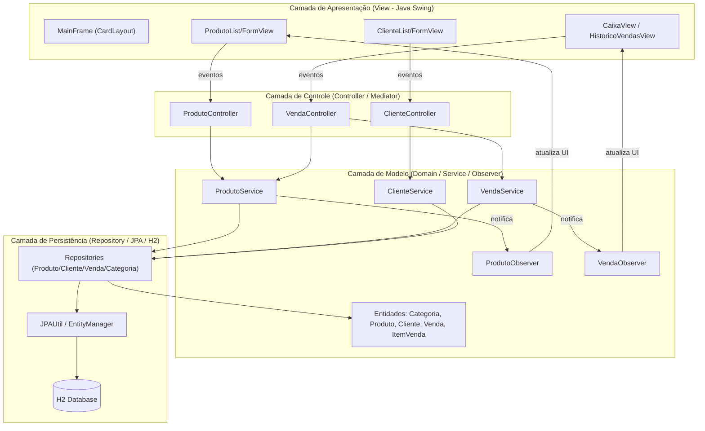
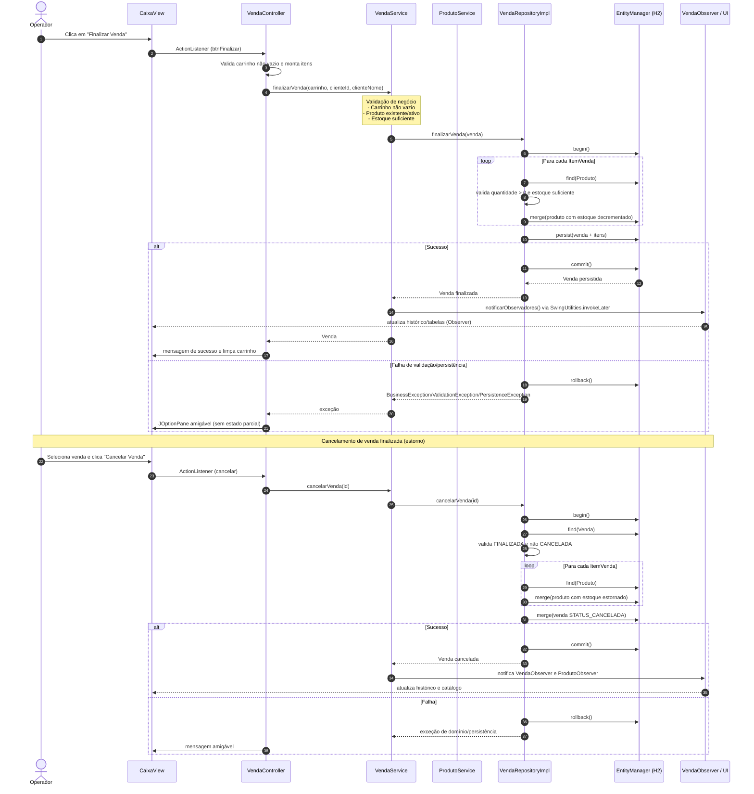
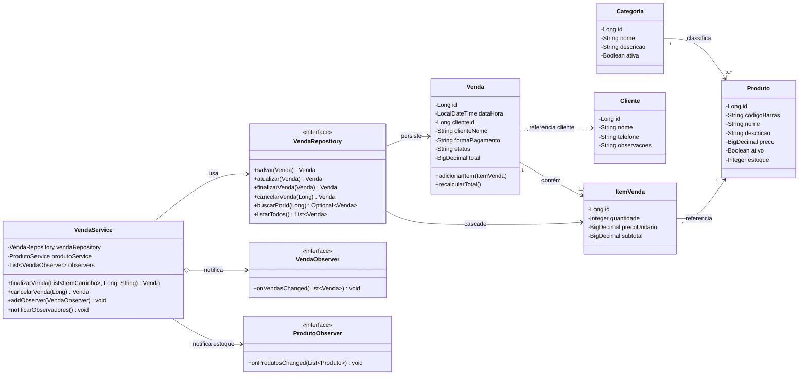



# Sabor Express PDV — Sistema de Gestão para Lanchonete

> Projeto prático (PBL) de **Técnicas de Programação II** baseado no PDV Core.  
> Sistema desktop em **Java 17, Swing, JPA/Hibernate 6, H2**, com arquitetura **MVC**, padrões **Repository/Observer** e transações atômicas.

## 1. Contexto

O **Sabor Express PDV** evolui o PDV base para o nicho de lanchonete, cobrindo cadastro de produtos/categorias, clientes e fluxo de venda com validação, persistência transacional, baixa/estorno de estoque e atualização reativa da interface.

## 2. Objetivos técnicos

- Aplicar **MVC** com separação entre View, Controller, Service e Repository.
- Usar **JPA/Hibernate** com banco **H2** embutido para persistência ORM.
- Implementar **Observer** para atualização reativa da UI.
- Garantir regras de negócio e transações com **commit/rollback**.
- Manter versionamento colaborativo com **Gitflow** e Conventional Commits.

## 3. Funcionalidades

- **Cardápio/Produtos**: cadastro, edição, exclusão lógica/ativa-inativa conforme regra, busca, categoria e estoque.
- **Clientes**: cadastro e consulta para uso no caixa.
- **Caixa/Venda**: montagem de carrinho, validação de produto/estoque, finalização com baixa de estoque atômica.
- **Cancelamento**: cancelamento de venda finalizada com estorno de estoque e status `CANCELADA` (Card 17).
- **Histórico**: listagem de vendas e detalhes.
- **Exceções**: `BusinessException`, `ValidationException`, `PersistenceException` com tratamento amigável na UI.

## 4. Arquitetura e padrões

- **MVC**: Views Swing não acessam repositório; Controllers orquestram; Services concentram regras; Repositories isolam JPA.
- **Repository**: interfaces e implementações JPA por agregado.
- **Observer**: `ProdutoObserver` e `VendaObserver` notificam UI via `SwingUtilities.invokeLater`.
- **Transação atômica**: operações de venda/cancelamento usam `begin/commit/rollback` no `EntityManager`.

## 5. Diagramas Arquiteturais (Mermaid)

### 5.1. Visão Geral da Arquitetura em Camadas (Sabor Express PDV)



### 5.2. Diagrama de Sequência: Fluxo de Venda (Sabor Express PDV)

O diagrama detalha a finalização de venda no caixa, incluindo validação, transação atômica com baixa de estoque, rollback em falha e notificação reativa da UI (Observer). Também contempla o cancelamento de venda finalizada com estorno de estoque (Card 17, validado).



### 5.3. Diagrama de Classes: Domínio e Padrões (Sabor Express PDV)

O diagrama reflete as entidades reais do domínio e os padrões Repository/Observer usados pelo Sabor Express PDV.



## 6. Stack tecnológica

| Tecnologia | Uso |
|---|---|
| Java 17 (LTS) | Linguagem base |
| Java Swing + FlatLaf | Interface desktop |
| Jakarta Persistence 3.1 / Hibernate 6 | ORM e transações |
| H2 Database | Banco embutido (`./data/pdv_db`) |
| Maven Wrapper | Build/teste reprodutível |
| JUnit 5 | Testes automatizados |

## 7. Estrutura do projeto

```text
src/
├── main/java/br/fiesp/senai/unisenai/saborexpress/pdv/
│   ├── Main.java
│   ├── config/
│   ├── controller/
│   ├── model/
│   │   ├── entity/        # Categoria, Produto, Cliente, Venda, ItemVenda
│   │   ├── exception/     # Business/Validation/PersistenceException
│   │   ├── observer/      # ProdutoObserver, VendaObserver
│   │   ├── repository/    # interfaces + impl JPA
│   │   └── service/       # regras de negócio e notificações
│   ├── util/
│   └── view/              # MainFrame, Produto/Cliente/Caixa/Histórico, tablemodels
└── main/resources/META-INF/persistence.xml
```

## 8. Como compilar e executar

### Pré-requisitos
- Java JDK 17+ (`java -version`).

### Testes

```powershell
$env:JAVA_HOME='C:\Users\Jeniffer.Oliveira\AppData\Local\Programs\Microsoft\jdk-17.0.21.21-hotspot'
.\mvnw.cmd test
```

### Executar aplicação

```powershell
$env:JAVA_HOME='C:\Users\Jeniffer.Oliveira\AppData\Local\Programs\Microsoft\jdk-17.0.21.21-hotspot'
.\mvnw.cmd exec:java
```

### Empacotar

```powershell
.\mvnw.cmd clean package
java -jar target/exemplo_persistencia_JavaSwing-1.0.0.jar
```

> Observação: se o H2 local tiver schema antigo, feche a aplicação e remova `./data/pdv_db*` antes de subir novamente.

## 9. Gitflow e evidências

- Fluxo: `main` ← `develop` ← `feature/*`/`fix/*`/`docs/*`, PR para `develop`.
- Commits: Conventional Commits (`feat`, `fix`, `docs`, `refactor`, `test`, `chore`).
- Evidências: PRs com descrição/checklist, revisão cruzada, histórico Git e testes Maven.

## 10. Referências

- Gamma et al. *Design Patterns*. Addison-Wesley, 1995.
- Freeman & Freeman. *Head First Design Patterns*. O'Reilly, 2004.
- Fowler. *Patterns of Enterprise Application Architecture*. Addison-Wesley, 2002.
- Jakarta Persistence 3.1: https://jakarta.ee/specifications/persistence/3.1/
- Hibernate ORM: https://hibernate.org/orm/documentation/
- H2 Database: https://www.h2database.com/html/main.html
